

  

  

  

  
  
  

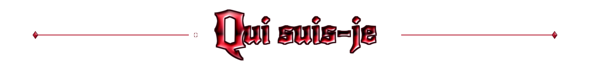

  Je suis <b>sk8rt</b> et je code en <b>TypeScript</b> et en <b>Python</b> : 
  apps mobiles <b>React Native / Expo</b>, outils <b>Windows</b>, vision par ordinateur avec <b>OpenCV</b>.

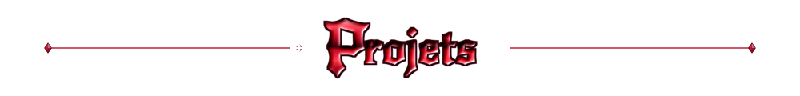

  <a href="https://github.com/ninoelhaj/paperasse">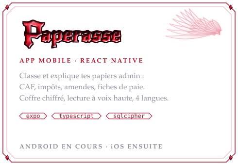</a>
  <a href="https://github.com/ninoelhaj/crochetage">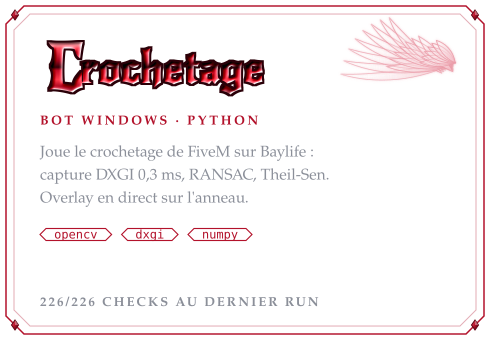</a>

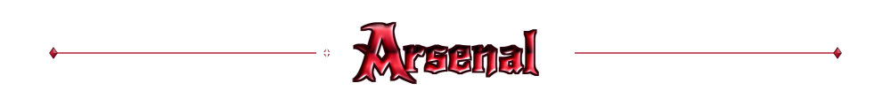

  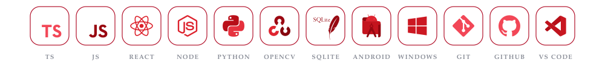

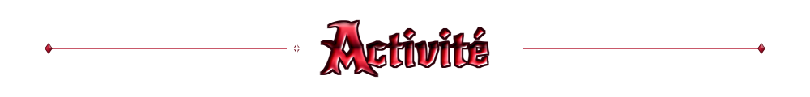

  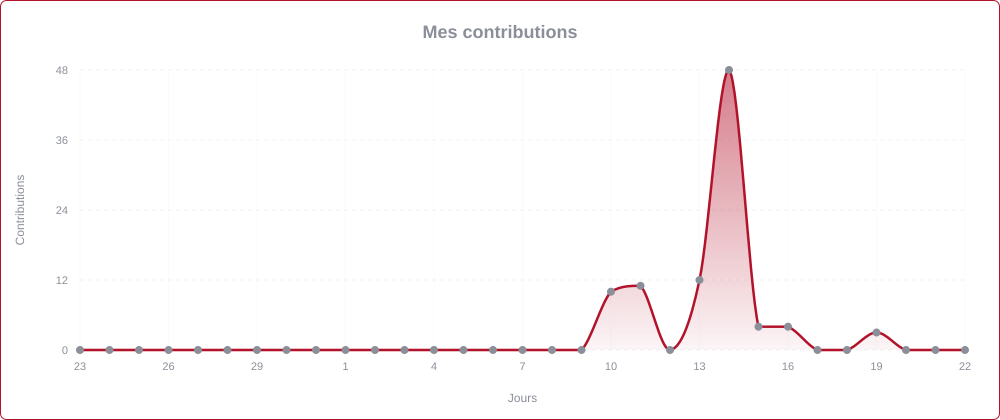

  

  

  <a href="https://ko-fi.com/sk8rt">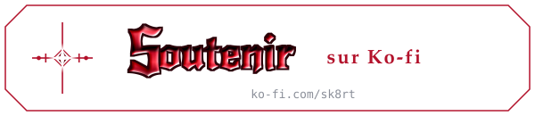</a>

